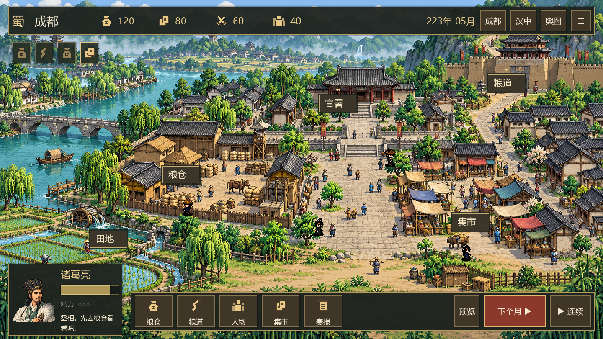

# 卧龙：科技兴汉

当前为 **v0.4 音乐与音效版**：现代人醒在诸葛亮身上，先用仓储常识帮助蜀汉整备后方。穿越开场、实操教学、现代记忆札记，以及城镇背景音乐与操作音效已接入。经营切片可以从223年五月玩到224年十月，保存、读档并查看筹备复盘。

## 开始玩

双击根目录的 [启动游戏.cmd](启动游戏.cmd)。本机已安装 Godot 4.7.2。

1. 新局播放穿越序章，进入成都后跟随左上引导和设施金色圈。点粮仓了解改良办法，在人物头像中选蒋琬，再点「委任并开工」。
2. 点城门的「粮道」，安排每月8粮；点「整备粮道」，委任李严修整道路。
3. 点击「下个月」或「连续」。仓储阶段完成后，再点粮仓继续推广。
4. 224年十月检视仓储推广、粮道整备、汉中储粮≥50、留钱≥10四项成果。

空格推进一月，Ctrl+S保存，Esc暂停。底栏「札记」解释现代知识与落地过程；各设施右上「?」解释消耗与规则；行囊「怎么玩」提供操作总览。可以收起引导，再从行囊恢复；序章和成果对话出现时暂停推进。

右上「☰ → 声音设置」分别调整背景音乐与操作音效，可全部静音、试听音效。声音偏好独立保存。成都与汉中/舆图使用不同器乐，切换淡化、曲终循环，对话降低音乐，窗口切到后台暂停声音。素材作者与CC0授权见[音频素材与接入说明](docs/v0.4音频素材与接入说明.md)。

这是第一个完整经营切片。南中、北伐、其余技术和223—228年完整流程尚未接入，当前参数用于试玩验证。暂未制作独立发行安装包。



## 编辑与继续开发

双击 [打开编辑器.cmd](打开编辑器.cmd)，或原有「打开卧龙编辑器.lnk」。Godot右侧已加入「卧龙筹备」面板：可以调整开局粮钱、秋收、道路容量和损耗，保存原表备份，再点击「运行游戏」或按F5试玩。

参数修改后重启游戏生效。存档绑定参数表指纹，避免将旧游戏进度与新规则混用；继续旧存档时应恢复原参数表。

| 文件 | 用途 |
| --- | --- |
| [game/data/scenario.json](game/data/scenario.json) | 开局、收支、人物、项目阶段与粮道参数 |
| [game/scripts/simulation.gd](game/scripts/simulation.gd) | 月度结算、委任、库存、预览与存档 |
| [game/scripts/main.gd](game/scripts/main.gd) | 可操作界面、自动推进与筹备复盘 |
| [game/scripts/world_view.gd](game/scripts/world_view.gd) | 城镇与舆图、设施点击、行人与车队、成果反馈 |
| [game/scripts/officer_portrait.gd](game/scripts/officer_portrait.gd) | 人物头像图集 |
| [game/scripts/pixel_icon.gd](game/scripts/pixel_icon.gd) | 游戏资源与指令图标 |
| [game/addons/wolong_tools/plugin.gd](game/addons/wolong_tools/plugin.gd) | Godot参数编辑面板 |

界面目前由脚本搭建，运行主场景可看到完整效果。

## 素材与授权

v0.2新增三张原创生成场景与人物头像图集，来源、文件和完整提示词见[生成记录](game/assets/original/生成记录.md)。B.B.Bits免费NPC用于行走动画，村庄样包保留在本机。许可见[素材记录](game/assets/third_party/bbbits/LICENSE.md)，候选素材见[像素素材选型](docs/像素素材选型.md)。没有购买收费包。

原PNG禁止单独再分发，已从Git排除，本机文件保留。克隆源码后可自行从作者页面获取，按素材记录命名放入对应目录；缺少文件时游戏仍能用原生占位图运行。中文字体使用系统字体，不打包Windows字体文件。

## 验证

经营与存档的49项检查通过；新版界面通过21项检查，包含设施鼠标点击、人物委任、地图入城、运输、采购、快捷键、缩小窗口与完整一局。Godot参数面板沿用已验证版本。日志在logs目录。

```powershell
& '.\.tools\godot\4.7.2\Godot_v4.7.2-stable_win64_console.exe' --headless --path '.\game' --script 'res://tests/test_simulation.gd'
& '.\.tools\godot\4.7.2\Godot_v4.7.2-stable_win64_console.exe' --headless --path '.\game' --script 'res://tests/test_ui.gd' -- --no-intro
```

## 设计资料

- [游戏设计大纲](设计大纲初版.md)：v0.3.1，完整首版目标为223—228年。
- [经营路线纸面推演](docs/经营路线纸面推演.md)。
- [经营路线月度验证](docs/经营路线月度验证.md)及[月度台账](docs/月度验证台账.csv)。
- [开发准备与环境记录](docs/开发准备.md)。
- [v0.1实现与试玩说明](docs/v0.1实现与试玩说明.md)。
- [v0.2界面重做说明](docs/v0.2界面重做说明.md)。

.tools为本机引擎和下载缓存，game/.godot为编辑器缓存，logs为验证产物，均不纳入版本控制。Git已初始化，尚未创建提交或远端仓库。
