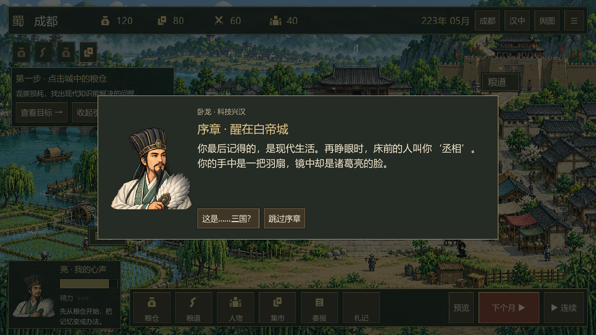
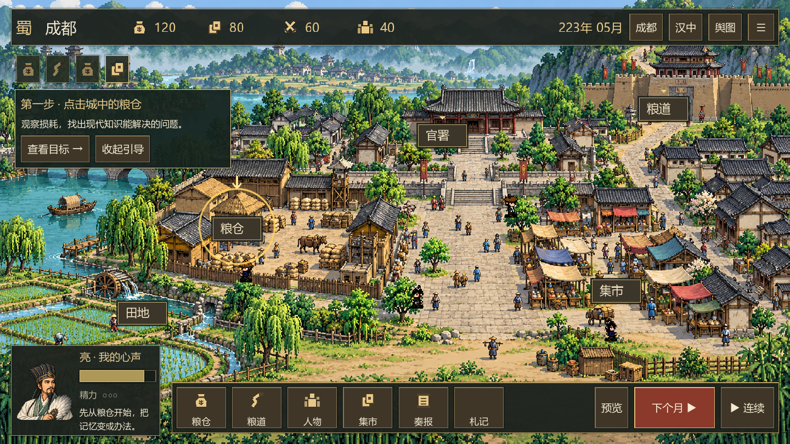
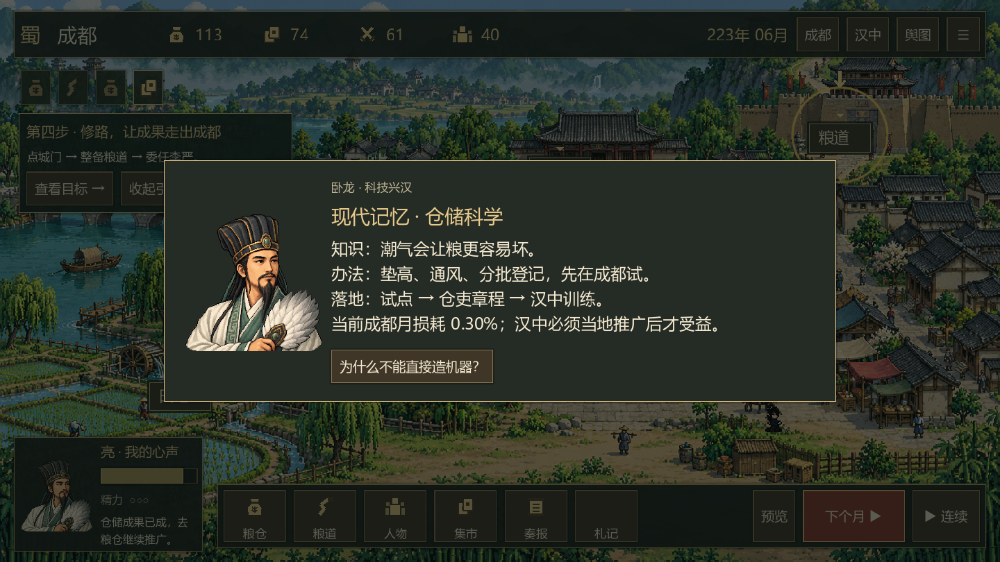

# v0.3：穿越身份、知识落地与新手引导

新局先播放三段人物开场：现代人魂穿诸葛亮，接受兴汉责任，再转入223年五月成都。正文每段只讲一个问题，城镇场景保留在背景。

引导根据真实状态推进：观察粮仓 → 委任试验 → 等待结算 → 整备粮道 → 安排运粮 → 等待实际到货 → 仓储制度与汉中推广。目标设施有金色脉冲圈。失败的结算不会推进引导，收起引导不会修改资源或跳过项目；行囊可以恢复引导。

仓储试点、常规执行、汉中推广、粮道完成、首次到货各有负责人反馈与现代主角的思考。成果沿用实际月度模型：工期、粮钱、劳力、地区采用和运输延迟均真实结算；没有额外赠送教程粮钱，也没有直接解锁高级工业。仓储叙事解释现有损耗改善机制，不是新增独立的湿度或科学对照实验模拟。

底栏「札记」展示仓储原理、落地顺序、当前损耗和成果。设施面板「?」说明规则与代价，行囊「怎么玩」提供总览。对话期间暂停自动和快捷键推进。教学记录与已见成果写入原有存档；旧版无剧情字段的存档仍可读取，首次进入会补上序章。

验证：49项经营测试、31项界面测试通过；图形测试实际使用Godot/OpenGL渲染，检查开场、引导、试点成果、札记、保存教学进度和完整经营路线。

范围：仍为223年五月到224年十月的后方经营切片。科技路线分支、其他技术、南中与北伐尚未实现。

