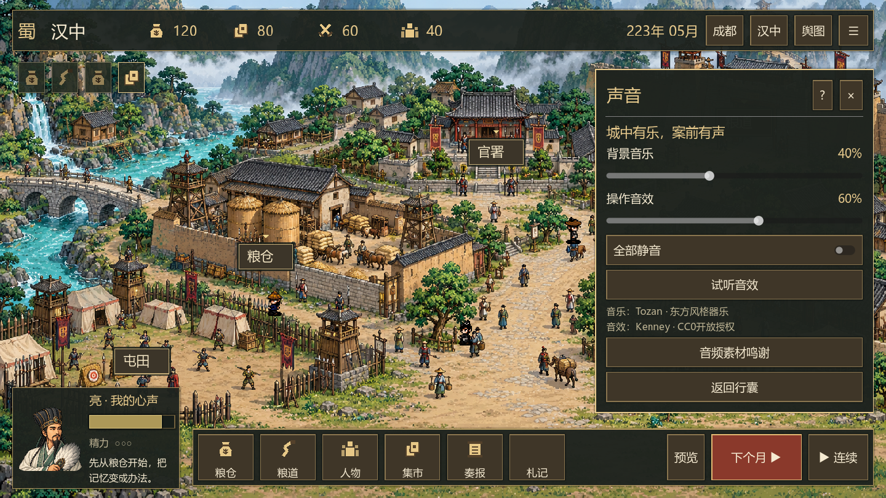

# v0.4：音乐与音效

## 素材来源

2026-10-01查阅原作者条目并下载以下文件。全部采用CC0开放素材授权，可以修改、随游戏分发并用于商业游戏。这里的“开放”指音频资产的授权；不是从其他商业三国游戏提取音乐。

| 作者 / 作品 | 授权与来源 | 游戏用途 |
| --- | --- | --- |
| Tozan / Asianoriental1 | [原作者条目，CC0](https://opengameart.org/content/asianoriental1) | 成都、开场背景器乐 |
| Tozan / Asianoriental2 | [原作者条目，CC0](https://opengameart.org/content/asianoriental2) | 汉中、舆图背景器乐 |
| Kenney / Interface Sounds 1.0 | [官方素材页，CC0](https://kenney.nl/assets/interface-sounds) | 从100个音效中选用10个操作提示音 |

约5.3MiB音频数据，原始Ogg内容未加工。Tozan采用东方风格器乐音色，并非汉代音乐复原。Kenney素材为提示音，不是古代集市、施工或粮车环境录音。

文件位于game/assets/audio。保留Kenney随包License.txt、Tozan作品与下载地址记录、CC0法律文本副本；checksums.json记录12个文件大小与SHA256。游戏行囊、声音设置保留作者鸣谢。

## 游玩体验

最新音色调整：操作提示统一使用从Kenney的click_002.ogg加工得到的click_crisp.wav，约9.9毫秒。去除起始静音，淡出尾部，所有操作音量一致。原来的面板、翻页、拨弦和钟声均不再触发；音乐保持原有配乐。62项真实图形与音频检查通过。

右上行囊「声音设置」可独立调节背景音乐与操作音效，提供静音、试听及鸣谢入口。默认音乐35%、音效60%，另外施加内部混音衰减；百分比是玩家相对音量偏好。

切城切曲交叉淡化约1.2秒，普通面板刷新不重启音乐。曲终同曲交叉淡化后循环；长曲并非原生无缝短循环，交叠用于避免硬切。对话时音乐降至正常输出的65%。窗口进入后台暂停音乐并停止短音效，回来继续音乐。

点击、面板开关、翻页、开工、交易、月末、到货、成果与错误有相应提示。一次操作同时请求点击声与结果声时，在播放前合并，结果提示替代普通点击，只播放一次。短音效使用单个播放器，快速点击不会堆积旧声音；普通点击衰减更低，没有悬停连响。

声音偏好保存在user://audio.cfg，与经营存档分离，读档、新局不会重置偏好。自动保存发生在拖动完成、滑条离开焦点、静音变化、返回行囊、退出游戏时。

## 验证

点击重复音效修复后，58项无界面检查、60项真实图形检查通过。新增回归覆盖按钮和面板双重请求只播放一次、多种结果合并、静音取消待播音效、连续独立点击各响一次且不叠加播放器。

54项无界面UI/音频检查、56项真实图形UI/音频检查通过。新增检查覆盖素材解码、切城交叉淡化、刷新不重启、曲终循环、独立滑条、即时静音、偏好保存恢复和后台暂停。图形测试使用Windows真实音频驱动抓取Godot输出PCM，音乐、音效均非静音且样本峰值低于削波阈值；这验证播放链路，不等同于主观听感评审。原49项经营结算检查继续通过。

测试使用独立的test-ui-audio.cfg，不覆盖玩家声音偏好。播放器退出时停止并释放音频，测试无资源泄漏警告。

